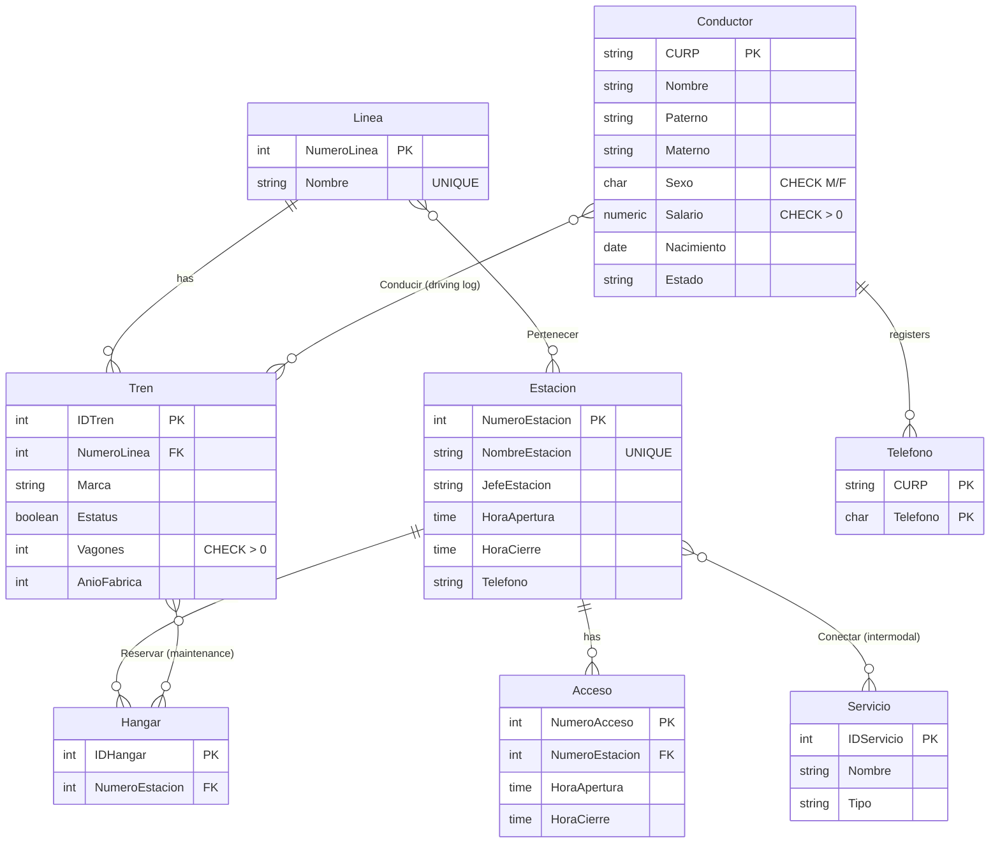

# Metro CDMX — Relational Database (PostgreSQL)

A relational database modeled on Mexico City's subway system, built as the final project of a **Data Management** course at the Faculty of Sciences, UNAM (Actuarial Science), December 2025. It was developed by a five-person team ("DataManagers") and covers the full workflow: schema design with integrity rules, bulk data loading, and 25 analytical and maintenance queries.

**Stack:** PostgreSQL · SQL (DDL / DML / DQL) · pgAdmin 4 · synthetic data from Mockaroo

## Data model

Twelve tables: five core entities, one multivalued attribute, and six relationship tables.



### Design decisions

- **Deliberate delete policies.** `ON DELETE CASCADE` for entities that cannot exist without their parent (a station's accesses, a driver's phone numbers, association rows). `ON DELETE RESTRICT` for critical catalogs, so a line with trains or a station with hangars cannot be removed by accident.
- **Constraints that encode business rules.** `CHECK` on sex, salary and number of cars; `UNIQUE` on line and station names; `NOT NULL` on operating hours.
- **A driving log, not just a current assignment.** `Conducir` uses a composite temporal key `(IDTren, CURP, Fecha, HoraInicio)`, so the same driver and train can appear on different dates and the history is preserved.
- **Open-ended maintenance records.** `Reservar.FechaFin` is nullable: a missing end date means the train is still in the hangar.
- **Multivalued attribute normalized.** Driver phone numbers live in their own table with a composite key that prevents duplicates.
- **Re-runnable schema.** The DDL starts with `DROP TABLE IF EXISTS ... CASCADE`.

## Data

- **1,650 driver records** generated with Mockaroo (synthetic, no real personal data), split into two files because of the generator's row limit.
- **Hand-written infrastructure:** 12 lines, 194 stations, 4 intermodal services, 776 station accesses, 10 hangars, trains, and their assignments.
- **A few curated records** (some with pop-culture names) inserted so that every query has something meaningful to find.

## How to run

Requires PostgreSQL (tested on 16) and `psql` or pgAdmin 4.

```bash
createdb db_metro
psql -d db_metro -f sql/01_schema_ddl.sql
psql -d db_metro -f sql/02_load_drivers_part1.sql
psql -d db_metro -f sql/03_load_drivers_part2.sql
psql -d db_metro -f sql/04_populate_infrastructure.sql
psql -d db_metro -f sql/05_queries.sql
```

Expected row counts after step 4:

| Table | Rows | Table | Rows |
|---|---|---|---|
| Linea | 12 | Acceso | 776 |
| Estacion | 194 | Telefono | 1,650 |
| Conductor | 1,650 | Pertenecer | 192 |
| Servicio | 4 | Conducir | 386 |
| Tren | 387 | Reservar | 6 |
| Hangar | 10 | Conectar | 4 |

> **Heads-up:** `05_queries.sql` ends with data-modifying statements (queries **w**, **x**, **y**: a salary raise, a deletion and a bulk insert). Run it on a disposable database, or wrap it in a transaction.

## Queries (a–y)

`05_queries.sql` answers 25 business questions, for example:

- stations per line, and trains per line, brand and status;
- drivers by time window, age range, gender, state of origin and salary relative to the average;
- trains sent to maintenance on a given date, and reservations by hangar;
- stations with no hangar, drivers with no assigned train, stations connected to other transport services;
- maintenance counts by brand;
- a 15% salary update, a conditional deletion of old trains and a bulk insert of a new fleet.

They range from aggregations and multi-table joins to anti-joins (entities with no related records), date arithmetic, pattern matching and data modification.

## Repository structure

```
sql/
  01_schema_ddl.sql                 Schema, constraints and integrity policies
  02_load_drivers_part1.sql         Synthetic drivers (batch 1)
  03_load_drivers_part2.sql         Synthetic drivers (batch 2)
  04_populate_infrastructure.sql    Lines, stations, trains, hangars, accesses, assignments
  05_queries.sql                    Queries a–y
```

SQL comments are in Spanish, the original language of the course.

## Team

Team project by **DataManagers** (five students, Faculty of Sciences, UNAM).
